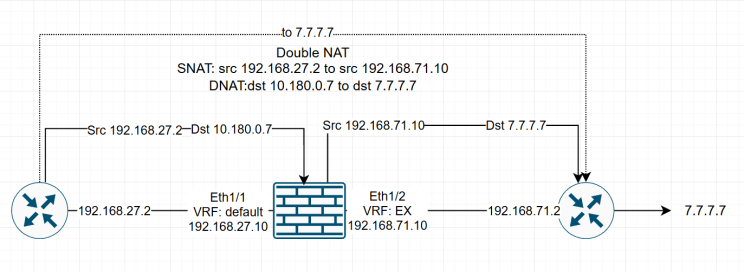
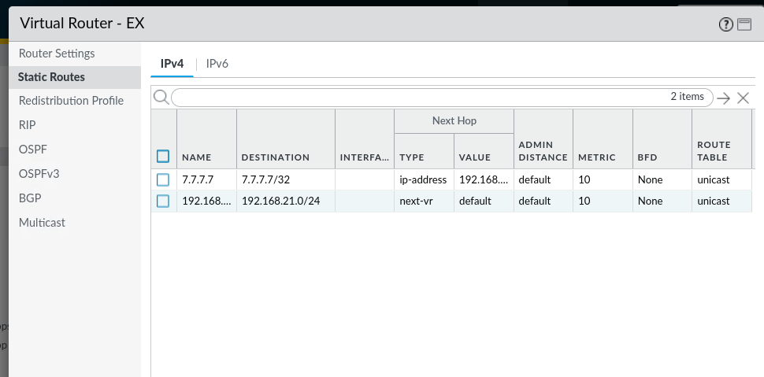
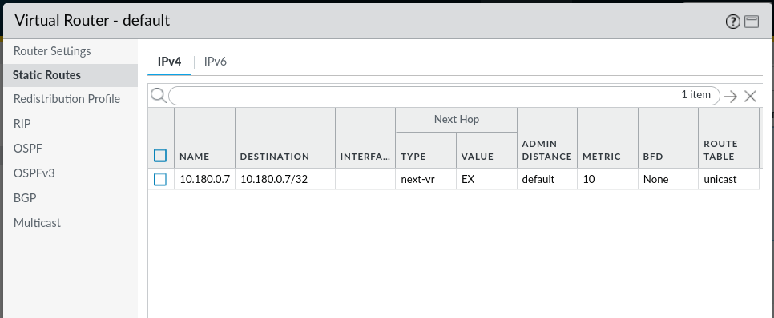
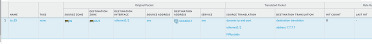
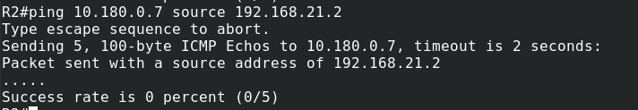
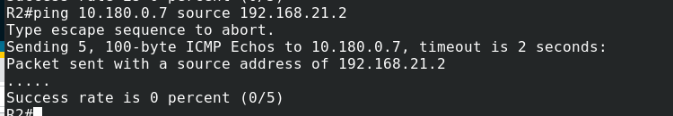
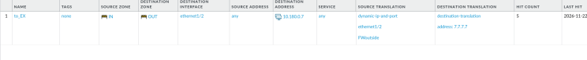
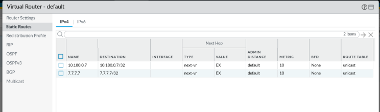
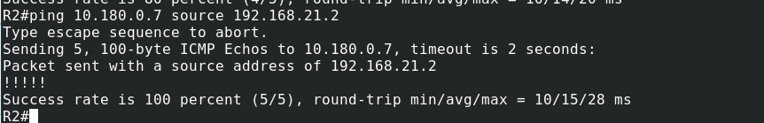

Have you still remembered Alex? He had just joined the network team a few days ago, and he had already finished a lot of tasks. He is satisfied with the current job. One day he got a task: set up a connection from the company network to an external environment called EX, which is a stock exchange.

There were two requirements. First, EX traffic had to stay in a separate routing table. Second, the EX team had an IP allowlist. They would only accept traffic from an approved source IP.

So Alex needed two things on the Palo Alto firewall: separate virtual routers, and both source NAT and destination NAT.

At first, the routing looked simple. He added the minimum configuration, ran a ping test, and got nothing. This is how he worked through it.

## 1. The setup



The firewall had two Layer 3 interfaces:

- ethernet1/1: `192.168.27.10`, in the default virtual router, zone IN.
- ethernet1/2: `192.168.71.10`, in the EX virtual router, zone OUT.

In the live test, R2 sent ICMP from `192.168.21.2` to `10.180.0.7`. The real destination on the EX side was `7.7.7.7`.

Alex wanted the firewall to change the packet like this:

- Before NAT: source `192.168.21.2`, destination `10.180.0.7`.
- After NAT: source `192.168.71.10`, destination `7.7.7.7`.

The source NAT would make the traffic look like it came from the approved EX-facing firewall IP. The destination NAT would send it to the real server.

## 2. Start with the minimum routing

Alex first configured two routes in the EX virtual router:

- `7.7.7.7/32` to the router on the EX side.
- `192.168.21.0/24` with next VR `default`, for the return path.



Then he added just one route to the default virtual router:

`10.180.0.7/32` with next VR `EX`.



His thinking was simple. If the packet is going to `10.180.0.7`, send it to EX. EX already knows how to reach `7.7.7.7`.

That sounded reasonable. But there was a catch.

## 3. Add the NAT rule

Alex created one NAT rule called `to_EX`.

For the original packet, he used:

- Source zone: IN
- Destination zone: OUT
- Destination interface: ethernet1/2
- Destination address: `10.180.0.7`

For the translated packet, he set:

- Source NAT: dynamic IP and port, using the ethernet1/2 interface address (`192.168.71.10`).
- Destination NAT: `7.7.7.7`.



This is double NAT in the sense used in this article: the same flow gets both SNAT and DNAT. It is not the same as Palo Alto's separate bi-directional NAT option.

## 4. First ping: no reply

Alex went to R2 and ran:

```
R2#ping 10.180.0.7 source 192.168.21.2
```

The result was 0/5. All five packets timed out.



He went back to the firewall and checked the routing table. At that point, the default virtual router only had a route for `10.180.0.7/32`, pointing to the EX virtual router.

Alex started thinking about what would happen after DNAT. The original destination was `10.180.0.7`, but the firewall would change it to `7.7.7.7`.

So he added another route in the default virtual router:

`7.7.7.7/32` with next VR `EX`.

He ran the ping test again. Still no reply.



But this time, something had changed. The NAT hit count had increased to 5.



The NAT rule was now getting hits, but the traffic still was not working. At least Alex knew he was making some progress. He just had not found the whole problem yet.

## 5. Two destinations, two virtual routers

Alex took another look at how Palo Alto handles destination NAT.

The firewall can perform two route lookups when DNAT is involved. The first lookup uses the original destination address, before NAT. The second lookup uses the translated destination address.

In his case, those addresses were:

- Original destination: `10.180.0.7`
- Translated destination: `7.7.7.7`

The default virtual router now had routes for both addresses, and the NAT rule was getting hits.

But Alex noticed something else. In the EX virtual router, he had a route for `7.7.7.7`, but not for `10.180.0.7`.

That was the missing piece in this lab. His original route in the default virtual router pointed `10.180.0.7` to the EX virtual router, but EX did not have a route for that address.

A next-VR route does not mean the firewall can skip the routing table in the next virtual router. The destination still needs to be resolved there. And with NAT involved, looking only at the translated destination is not always enough.

## 6. One last route, and it worked

Alex went back to the EX virtual router and added a route for the original destination:

`10.180.0.7/32` to the EX-side next hop.

He kept the two routes in the default virtual router:



Time for another test. He went back to R2 and ran exactly the same command.

```
R2#ping 10.180.0.7 source 192.168.21.2
```

And finally, it worked. Success rate: 100% (5/5).



Alex opened the Palo Alto traffic log to double-check the result. The log showed:

- Original source: `192.168.21.2`
- Original destination: `10.180.0.7`
- NAT source IP: `192.168.71.10`
- NAT destination IP: `7.7.7.7`
- From zone: IN
- To zone: OUT
- Application: ping
- Action: allow

Everything looked right. The firewall was translating both addresses, forwarding the traffic through the EX side, and the ping replies were coming back.

The interesting part was that Alex had not changed the NAT rule at all. He had only added the missing routes.

## What Alex learned

Alex started with what looked like a simple NAT task. In the end, it taught him a useful lesson about routing across Palo Alto virtual routers.

There were three things worth remembering.

First, DNAT can involve two route lookups: one for the original destination and another for the translated destination.

Second, a NAT hit count does not mean the connection is working. Alex saw five NAT hits while the ping was still failing.

Third, do not forget to check the routing table in the next virtual router. A route pointing to another virtual router does not automatically mean that virtual router knows how to reach the destination.

## 7. Why no route to 192.168.71.0/24 in default?

Alex also noticed something else. He never added the EX-facing subnet, `192.168.71.0/24`, to the default virtual router. Yet the ping worked.

The reason is that `192.168.71.10` is the translated source IP, not the destination.

Normal forwarding looks up the destination IP. For outgoing traffic, the final destination is `7.7.7.7`. The default virtual router hands that destination to EX. Then EX uses its own route and connected network to reach the next hop on the EX side.

For the return packet, Palo Alto uses the existing session and reverses the NAT changes. The EX virtual router also has a route back to `192.168.21.0/24` through the default virtual router.

So Alex did not have to leak the entire `192.168.71.0/24` subnet into the default virtual router just because he used that address for SNAT.

## 8. One question

What destination IP addresses need to be set on the security policy?
